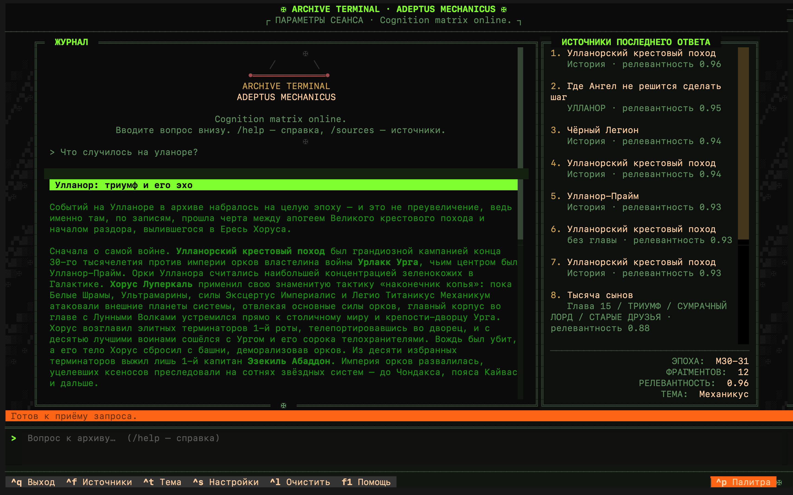
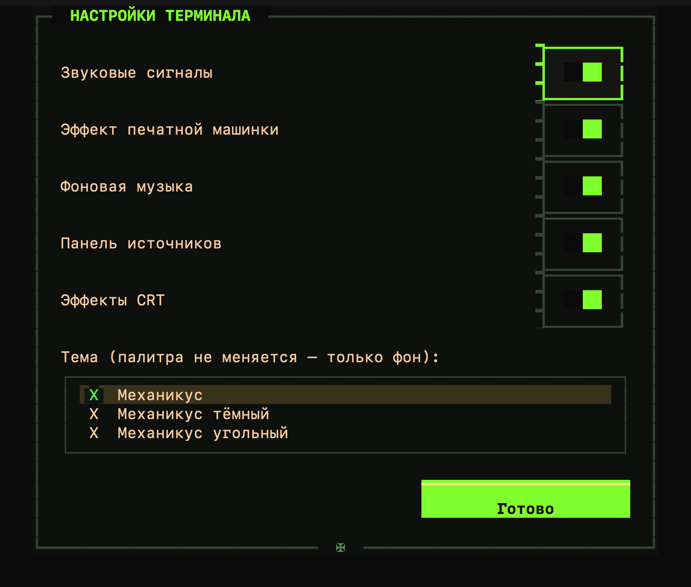

# Warhammer Archivist

Локальный RAG-чат-бот по вселенной Warhammer 40000 (в первую очередь — цикл "Ересь Хоруса", его предыстории и завершение, плюс энциклопедические факты по всей вселенной). Отвечает на вопросы, опираясь только на текст загруженных источников, с указанием источников — без информации сверх контекста.

Векторный поиск и вся RAG-логика работают полностью локально. Для генерации ответов используется DeepSeek API (OpenAI-совместимый протокол). Персона бота — техножрец Адептус Механикус.

## Как это устроено

```
book/
  horus_heresy/    -> основной 54-томный цикл (нужно наполнить самостоятельно)
  primarchs/       -> серия "Primarchs", предыстории примархов (опционально)
  siege_of_terra/  -> завершение цикла, "Осада Терры" (опционально)
  night_lords/     -> трилогия Night Lords (опционально)
data/processed/
  books/           -> книги, конвертированные в JSON по главам
  wiki/            -> статьи русской Warhammer 40k Fandom-вики в том же формате
  chunks.jsonl      -> все источники, нарезанные на чанки для эмбеддингов
data/chroma_db/    -> локальная векторная БД (ChromaDB)
src/
  fb2_to_json.py      — конвертация книг (.fb2/.epub) в структурированный JSON
  wiki_to_json.py     — выгрузка и парсинг статей Fandom-вики (MediaWiki API)
  chunk_books.py      — нарезка книг и вики-статей на чанки
  embed_and_index.py  — расчёт эмбеддингов и инкрементальная заливка в ChromaDB
  retriever.py         — гибридный поиск (dense + BM25, RRF) + cross-encoder reranker + адаптивная глубина выдачи + поиск по названию
  generator.py          — промпт, разделение эпох, коррекция опечаток, вызов DeepSeek API
  persona.py             — канонические ответы на вопросы о личности бота (общие для обоих интерфейсов)
  tui.py                   — основной интерфейс: полноэкранный TUI в стиле arct (Textual)
  chat.py                 — точка входа: TUI по умолчанию, старый CLI как fallback
  cli.py                   — старый построчный CLI (fallback для пайпов/скриптов и машин без Textual)
  ui.py                   — оформление терминала (баннер, сплэш, звук)
```

Эмбеддинги — `intfloat/multilingual-e5-large` (sentence-transformers), векторная БД — ChromaDB, локально на диске.

Полный пересчёт эмбеддингов для всей базы (~64k чанков) занимает несколько часов на Apple Silicon (M1, 8 ГБ RAM) — нужен только при смене модели эмбеддингов, а не при обычном добавлении новых книг (для этого `embed_and_index.py` работает инкрементально).

## Установка

```bash
python3 -m venv .venv
source .venv/bin/activate
pip install -r requirements.txt
```

Создай `.env` из шаблона и впиши свой ключ DeepSeek (получить на [platform.deepseek.com/api_keys](https://platform.deepseek.com/api_keys)):

```bash
cp .env.example .env
```

## Наполнение базы книгами

Это единственный вручную наполняемый шаг — сам репозиторий книг не содержит (авторские права). Положи свои `.fb2`/`.epub` файлы в `book/<подпапка>/` в формате имени `NN_Название_Автор.расширение`, затем зарегистрируй их в `BOOK_META` в `src/fb2_to_json.py` (номер, название, автор, цикл).

## Наполнение базы вики (опционально)

`src/wiki_to_json.py` тянет статьи с русского раздела Warhammer 40k Fandom-вики через MediaWiki API (Lexicanum блокирует программный доступ, поэтому используется Fandom):

```bash
python src/wiki_to_json.py "Хорус,Магнус"      # конкретные страницы
python src/wiki_to_json.py --category Примарх   # все страницы категории
python src/wiki_to_json.py --all                # вся вики (тысячи страниц, ~1.5-2 часа)
```

## Пересборка индекса

После добавления книг и/или вики прогони по порядку:

```bash
python src/fb2_to_json.py     # книги -> data/processed/books/*.json
python src/chunk_books.py     # книги + вики -> data/processed/chunks.jsonl
python src/embed_and_index.py # -> data/chroma_db/ (инкрементально — эмбеддит только новое)
```

## Запуск

```bash
./run.sh
```

или дважды кликнуть `Warhammer Chat.command`.

Интерфейс — полноэкранный TUI в стиле arct (arc-academy-terminal) на Textual: прокручиваемая история чата (колесо мыши, PgUp/PgDn), строка ввода закреплена внизу, внизу — панель с горячими клавишами, сбоку — панель источников последнего ответа, есть командная палитра, справка, настройки и темы (цветовая палитра та же, что была: зелёный/латунь/кость/кровь/сталь — темы меняют только фон). Ответы бота — живой формат: жирный латунный заголовок по теме вопроса и рассказ абзацами; объём зависит от того, сколько данных нашлось.

Главное окно:

<p align="center">
  
</p>

| Клавиша | Действие |
|---------|----------|
| `Ctrl+F` | показать/скрыть панель источников последнего ответа |
| `Ctrl+K` / `Ctrl+P` | командная палитра |
| `Ctrl+S` | настройки (звук, эффект печатной машинки, музыка, тема) |
| `Ctrl+T` | следующая тема |
| `Ctrl+U` / `Ctrl+D` | прокрутка журнала вверх/вниз |
| `PgUp` / `PgDn`, колесо мыши | прокрутка журнала |
| `↑` / `↓` | история вопросов в строке ввода |
| `Tab` / `Shift+Tab` | автодополнение команды в строке ввода (повторное нажатие перебирает варианты) |
| `Ctrl+L` | очистить журнал |
| `F1` | справка |
| `Ctrl+C` / `Ctrl+Q` | выход |

Команды внутри чата: `/exit` (или `/quit`) — выход, `/sources` — источники последнего ответа, `/help` — справка, `/theme` — следующая тема, `/clear` — очистить журнал. Наберите `/` и нажмите `Tab` — команда дополнится (повторное нажатие перебирает варианты, `Shift+Tab` — назад). Настройки сохраняются в `terminal_config.json` рядом с проектом (на флешке — вместе с проектом). Любая клавиша во время печати ответа допечатывает его мгновенно.

Экран настроек (`Ctrl+S`):

<p align="center">
  
</p>

Если терминал не интерактивный (пайп/скрипт) или Textual не установлен — программа автоматически откатывается на старый построчный CLI (`src/cli.py`).

Поиск релевантных фрагментов идёт в три стадии: (1) гибридное извлечение — dense-поиск (эмбеддинги) и BM25 (по ключевым словам) объединяются через Reciprocal Rank Fusion, что спасает редкие имена и термины, которые dense-поиск теряет в семантическом "усреднении"; (2) кросс-энкодер reranker (`BAAI/bge-reranker-v2-m3`) пересортировывает кандидатов по фактической релевантности запросу; (3) глубина итоговой выдачи подбирается автоматически (`adaptive_k_relative` в `retriever.py`) по тому, как быстро падает релевантность после reranker'а — от вопроса к вопросу число используемых источников меняется само.

## Перенос на флешку/внешний диск

Готовую базу (эмбеддинги + chunks.jsonl) и код можно скопировать на внешний носитель и запускать без переустановки на каждом Mac того же типа процессора (Apple Silicon):

```bash
scripts/setup_portable.sh /Volumes/ИмяФлешки
```

Копирует код, `data/chroma_db`, `chunks.jsonl`, кэш моделей и создаёт venv прямо на флешке (`--copies`, без symlink'ов — нужно для exFAT/FAT32). `HF_HOME` в коде по умолчанию указывает на `hf_cache/` рядом с проектом, поэтому веса моделей не оседают на диске хост-машины.

Для Windows — на уже подготовленной флешке (данные и код скопированы, например, тем же скриптом с Mac):

```powershell
scripts\setup_portable.ps1 -Drive E:\
```

Ставит CPU-only сборку torch (без CUDA — обычная сборка с PyPI на ноуте без Nvidia GPU весит в разы больше без всякой пользы) в отдельный `.venv-win`, кэш `pip` перенаправлен на саму флешку. Перед тем как вынимать флешку из чужого/временного ноута — `scripts\end_session.ps1 -Drive E:\`: останавливает процессы, держащие файлы на диске, подчищает то, что могло случайно осесть в профиле пользователя Windows (кэш pip/моделей), и безопасно отключает том.

Если retrieval находит релевантные данные из разных эпох вселенной (Ересь Хоруса vs "текущее" 41-е тысячелетие) — вместо смешивания фактов в одном ответе бот покажет интерактивное меню выбора эпохи (стрелки `↑`/`↓` + `Enter`).

Перед поиском вопрос прогоняется через DeepSeek для исправления опечаток (особенно в специфичных терминах сеттинга) — если это не удаётся (нет сети, исчерпана квота), поиск просто идёт по исходному тексту вопроса.

## Опционально: звук и музыка

Положи файлы в `sounds/`: `startup.*`, `answer.*`, `exit.*`, `error.*` — короткие звуки на события, плюс любой mp3-трек как фоновая музыка (путь задаётся в `BACKGROUND_MUSIC_FILE` в `src/ui.py`). Без файлов бот работает тихо, ничего не ломается.

## Журнал изменений

Все работы над проектом, найденные ошибки и их исправления фиксируются в [CHANGELOG.md](CHANGELOG.md).
